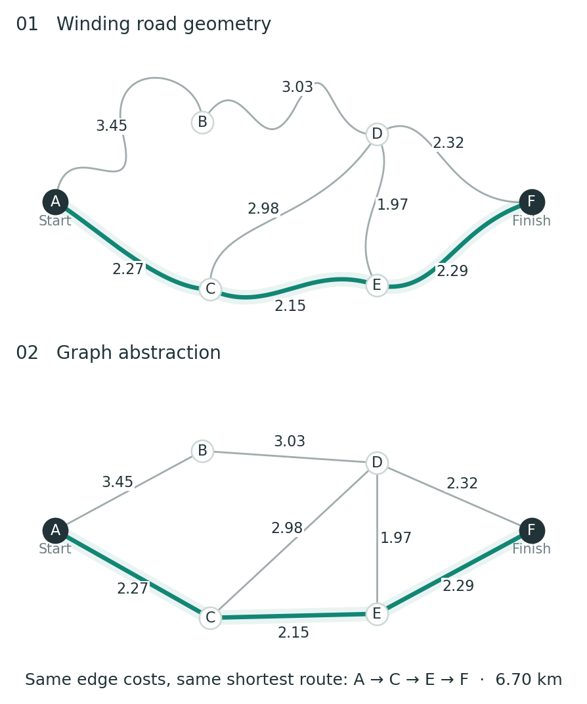

# Minimum Separation and Locality in Geometric Graph Traversal

By Jonathan R. Landers, November 22, 2026.

**[Read the paper](minimum_separation_traversal.pdf)** · [LaTeX source](minimum_separation_traversal.tex)

For planar vertices separated by at least `k`, with edges joining only endpoints at distance at most `R`, disjoint-disk packing gives

```text
maximum degree <= (1 + 2R/k)^2 - 1
edges          <= n * maximum_degree / 2
graph triangles <= n * maximum_degree * (maximum_degree - 1) / 6
```

With fixed `R/k`, both counts are linear in the number of vertices. A spatial hash constructs the full radius graph in expected linear time; BFS takes linear time and binary-heap Dijkstra takes `O(n log n)` time. The paper proves the bounds in fixed Euclidean dimension, explains the arithmetic and hash assumptions, and supplies counterexamples to stronger claims.

The results specialize standard packing and graph algorithms. Minimum separation alone permits complete graphs. The triangle bound counts three-edge cliques, not all triples or triangles sampled from a shape distribution. Straightening a road drawing preserves shortest paths only when the original road costs are retained.



## Reproduce

From the repository root, using its existing Python dependencies:

```powershell
python -m graph_traversal.experiment
python -m graph_traversal.validate
python -m graph_traversal.figures
```

Build the paper from this directory:

```powershell
pdflatex -interaction=nonstopmode -halt-on-error minimum_separation_traversal.tex
pdflatex -interaction=nonstopmode -halt-on-error minimum_separation_traversal.tex
```

The experiment records structural counts, not timings. Instances are square lattices of spacing `1.2`, perturbed in each coordinate by at most `0.07`, with seed `2026`. This guarantees separation at least `1.06`, so `k=1` is valid. Increasing the grid side expands the occupied region. A separate sweep changes `R` on fixed points.

At `n=2304`, `R/k=1.7`, the grid makes **18,294 distance evaluations**, compared with **2,653,056 all-pairs evaluations**. That is about 145 times fewer distance evaluations, not a measured runtime speedup. There are 6,747 edges and 4,470 graph triangles.

The independent validation compares adjacency and triangle lists with exhaustive enumeration, and Dijkstra distances with SciPy Floyd–Warshall. It includes boundary and disconnected cases and refines the sampled arc lengths of the curved-road example.

## Files

| File | Purpose |
| --- | --- |
| `minimum_separation_traversal.tex` / `.pdf` | Full paper, proofs, figures, and references |
| `traversal.py` | Radius-graph construction, Dijkstra, triangle enumeration, and road geometry |
| `experiment.py` | Reproduce the size and range sweeps |
| `measurements.csv` | Saved raw structural counts |
| `environment.json` | Generator and Python/NumPy metadata |
| `validate.py` | Independent reference checks |
| `figures.py` | Reproduce four figures |
| `figures/` | PDF and SVG vectors and PNG previews |

The grid relies on the separation promise for its complexity bound; it does not enforce a larger separation by removing vertices. Input coordinates and cutoff comparisons use floating-point arithmetic, while the theorems use exact arithmetic. The paper explains the distinction and the separate cost of obtaining road weights.
